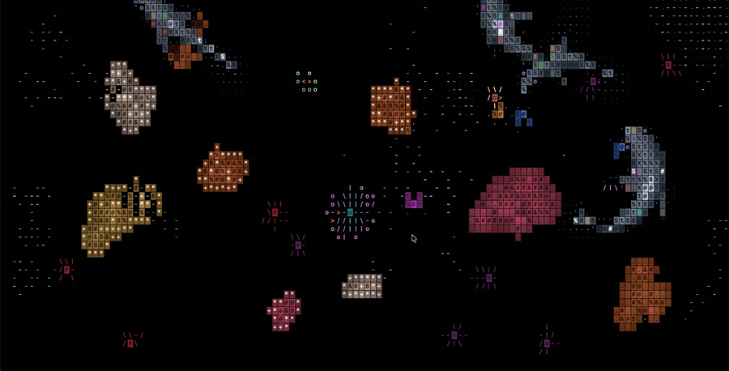

<div align="center">

# ⚡ SlapGlitch

### Slap your MacBook. Watch the screen glitch.

**A tiny menu-bar app that reads your MacBook's hidden motion sensor and tears the screen apart every time you smack it.**

[](https://github.com/DaniilPak/slapglitch/actions/workflows/ci.yml)
[](LICENSE)
[](#requirements)
[](main.swift)

</div>

<p align="center">
  <br>
  <sub>One slap, real time</sub>
</p>

> [!TIP]
> **From the maker of [ClarifierAI](https://tryclarifier.app)** — an AI writing keyboard
> that rewrites, paraphrases, translates and polishes your text right inside any app.
> A privacy-first Grammarly alternative.
> [iPhone](https://apps.apple.com/us/app/clarifierai/id6755627408) ·
> [Chrome](https://chromewebstore.google.com/detail/clarifierai/okpakmomhpgljjbcjkaiadmiegiohfge) ·
> [tryclarifier.app](https://tryclarifier.app)

---

Apple silicon MacBooks have an accelerometer that macOS doesn't expose through any
public API. SlapGlitch wakes it up, watches for sudden spikes, and when you slap the
laptop it grabs your screen and shreds it: torn slices, red/cyan chromatic
aberration, corrupted macroblocks, scanlines and, on hard slaps, an inverted flash.
The harder the slap, the bigger the glitch. Then everything snaps back to normal.

It's a toy. It's pointless. It's very satisfying.

## Requirements

- An Apple silicon **MacBook** (M2 or later) with the SPU motion sensor. Desktop Macs
  don't have one.
- macOS 14 Sonoma or later
- Xcode Command Line Tools to build (`xcode-select --install`)

## Build and run

```bash
git clone https://github.com/DaniilPak/slapglitch.git
cd slapglitch
./build.sh
open SlapGlitch.app
```

A ⚡ icon appears in the menu bar. Slap the side of your MacBook (gently, please).

On first launch macOS asks for **Screen Recording** permission. Grant it so the glitch
can tear apart your real screen. Without it, SlapGlitch falls back to a colored-noise
glitch drawn over the desktop.

To see the effect without slapping anything, choose **Test Slap** (⌘T) from the
menu, or launch with `open SlapGlitch.app --args --demo`.

## Modes

| Mode | What a slap does |
|---|---|
| **Glitch** | Tears the screen apart, then snaps back |
| **Broken Matrix** | "Kills" parts of the panel: dead columns, a rainbow band, dead rows. Stays until you choose **Repair Screen** (⌘R) |
| **Halloween** 🎃 | A 3D zombie sprints out from deep inside your screen and lunges at you. Launch straight into it with `open SlapGlitch.app --args --halloween` |

## Menu

| Item | What it does |
|---|---|
| **Enabled** | Turn slap detection on or off |
| **Mode** | Glitch, Broken Matrix or Halloween |
| **Repair Screen** | Undo Broken Matrix damage |
| **Slaps: N** | How many slaps this session |
| **Sensitivity** | Low (0.6 g), Medium (0.35 g) or High (0.18 g) above baseline |
| **Test Slap** | Trigger the current mode now |
| **Screen Recording Settings…** | Open the privacy pane to grant permission |

## How it works

- **[`Accel.swift`](Accel.swift)** finds the `AppleSPUHIDDevice` accelerometer through
  IOKit, switches its reporting on at 100 Hz, and decodes X/Y/Z from the raw HID
  reports. It keeps a slow-moving estimate of gravity and fires a slap when the
  acceleration magnitude jumps above the threshold, with a short cooldown.
- **[`main.swift`](main.swift)** captures each display with ScreenCaptureKit at half
  resolution, splits out red and cyan channels with Core Image, and animates a
  borderless overlay window per screen at 30 fps with Core Animation layers. The
  overlay ignores the mouse and sits above everything, including full-screen apps.

The accelerometer is undocumented, so a future macOS update could change how it
works.

## Privacy

Screenshots are taken only at the moment of a slap, kept in memory for the length
of the glitch (about a second), and never saved or sent anywhere. SlapGlitch makes
no network connections.

## Ideas and contributions

Pull requests are welcome. Some ideas:

- Sound effects that scale with slap strength
- More glitch styles (pixel sort, datamosh, CRT roll) with a picker in the menu
- Launch at login
- A signed, notarized release build

## Also by me: ClarifierAI

If you enjoyed slapping your laptop, you might like something useful too.
**[ClarifierAI](https://tryclarifier.app)** is an AI writing assistant built into your
keyboard: rewrite, paraphrase, translate, fix grammar and check politeness in any app,
without copy-pasting between tools. Made for non-native English speakers and anyone who
wants their messages to land.

- 📱 [ClarifierAI for iPhone](https://apps.apple.com/us/app/clarifierai/id6755627408)
- 🌐 [ClarifierAI for Chrome](https://chromewebstore.google.com/detail/clarifierai/okpakmomhpgljjbcjkaiadmiegiohfge)
- 🚀 [ClarifierAI on Product Hunt](https://www.producthunt.com/products/clarifierai-rewrite-text-2)

## License

[MIT](LICENSE) © Daniil Pak
